  

  <a href="https://www.linkedin.com/in/bhavana-tongare-73a6b5263"><b>LinkedIn</b></a>
  &nbsp;·&nbsp;
  <a href="https://github.com/Bhavana-Tongare"><b>GitHub</b></a>
  &nbsp;·&nbsp;
  <a href="https://my-sentiment-dashboard-26-30.streamlit.app/"><b>Live Dashboard</b></a>

## 01 · About

### Hello, I'm Bhavana.

I'm a B.Tech graduate in **Artificial Intelligence & Data Science** from **K.K. Wagh Institute of Engineering Education and Research, Nashik**.

I work across **data analysis, NLP and applied AI** with Python, SQL and Pandas. I like turning raw data into dashboards and tools people can actually use, from a sentiment analysis dashboard on thousands of product reviews to a real-time crowd-safety platform.

- 🧪 Focused on **Data Analytics, Data Science and AI/ML** roles
- 🏢 Project Intern at **Hindustan Aeronautics Limited (HAL)**, Jan – Mar 2026
- 📍 Nashik, India

## 02 · Proof, on the record

  

**Project Intern — Hindustan Aeronautics Limited (HAL)** · *Jan 2026 – Mar 2026*

- Built a dashboard tracking total, available, issued, overdue, calibrated and returned tools.
- Designed web pages with ASP.NET, .NET Framework, HTML/CSS and built backend components in Python.
- Managed Oracle SQL / PL-SQL queries supporting a tool management system.

<!-- Certifications: none could be verified from the resume or repositories.
     Add real ones here, e.g.  - **Certificate name** — Issuer, Year -->

## 03 · Selected projects

  

- **01 Customer Sentiment Analysis** — [Live dashboard](https://my-sentiment-dashboard-26-30.streamlit.app/) · [Source code](https://github.com/Bhavana-Tongare/customer-sentiment-dashboard)
- **02 Digital Kumbh — Pilgrim Safe Haven** — [Source code](https://github.com/Bhavana-Tongare/Digital-Kumbh)
- **03 AI Mental Wellness Platform** — source code is not public
- **More** — [codsoft-task](https://github.com/Bhavana-Tongare/codsoft-task): AI task exercises (rule-based chatbot, Tic-Tac-Toe AI, recommendation system)

## 04 · Skills

| Category | Tools & Technologies |
|:--|:--|
| **Programming & Backend** | `Python` `REST APIs` `JSON` `Debugging` |
| **Data & Databases** | `SQL` `PostgreSQL (Supabase)` `Oracle SQL / PL-SQL` `SQLite` |
| **Data Analysis** | `Pandas` `NumPy` `Data Cleaning` `Exploratory Data Analysis` |
| **NLP & ML** | `Hugging Face Transformers` `Sentiment Analysis` `Scikit-learn` `YOLOv8` `OpenAI API` `Dialogflow` |
| **Visualization** | `Matplotlib` `Seaborn` `Plotly` `Streamlit` |
| **Frontend** | `HTML` `CSS` `JavaScript` `React` `TypeScript` `Tailwind CSS` |
| **Tools** | `Git` `GitHub` `VS Code` `Jupyter Notebook` `Google Colab` `Android Studio` |

## 05 · Contribution graph

  

Generated from my real contribution data by a GitHub Action that refreshes every 12 hours.

## 06 · Let's connect

  <a href="https://www.linkedin.com/in/bhavana-tongare-73a6b5263"><b>LinkedIn</b></a>
  &nbsp;·&nbsp;
  <a href="https://github.com/Bhavana-Tongare"><b>GitHub</b></a>

  

